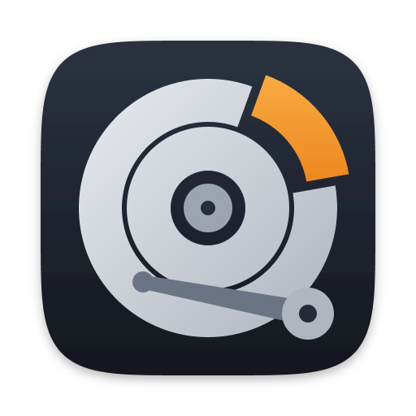
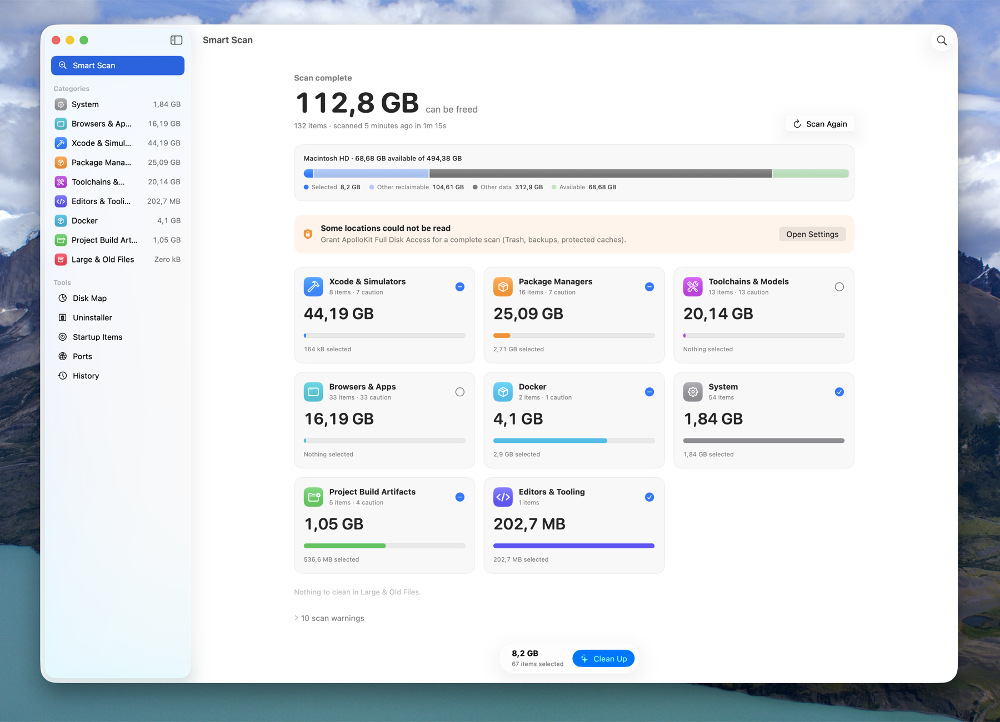
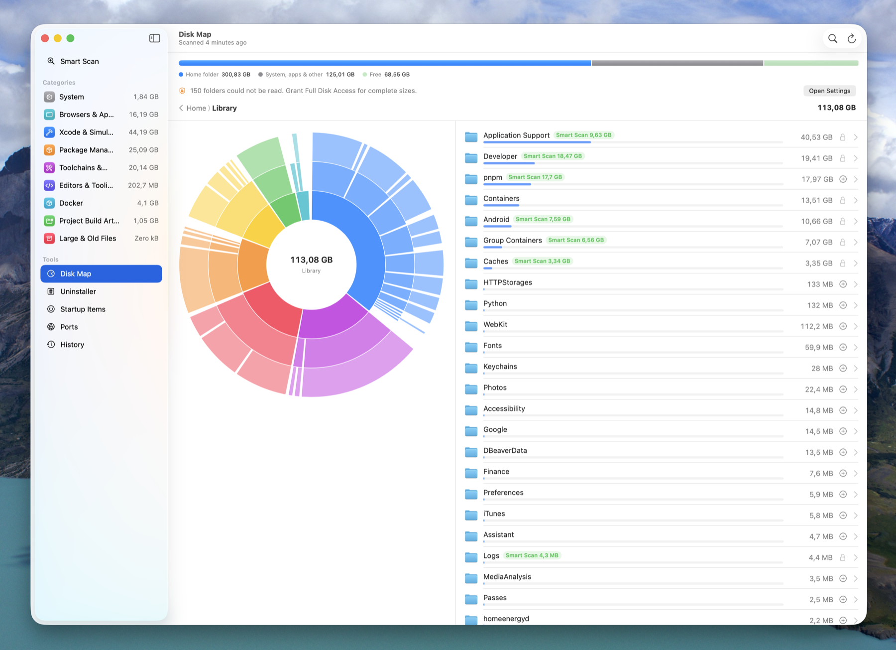

<div align="center">



# ApolloKit

**Your Mac is full of things you can rebuild. ApolloKit finds them.**

A native macOS cleanup kit for developers: DerivedData, simulators, `node_modules`, package caches,<br>
Docker layers, stale toolchains, plus the tools you keep opening Terminal for.

[](https://github.com/Apollosuny/ApolloKit/actions/workflows/ci.yml)




</div>

---

## Why

Generic cleaners don't know what a developer's disk looks like. The space goes to:

- `~/Library/Developer`: Xcode DerivedData, archives, device support files and simulator runtimes.
- Package stores: npm, pnpm, Yarn, Bun, Gradle, Maven, Cargo, Go, pip, CocoaPods.
- Every old project's `node_modules`, `target`, `build` and `.venv`.
- Docker images and build cache.

`du -sh * | sort -h` gets you part of the way. ApolloKit knows where all of these live, which ones are safe to rebuild, and which ones need a second look.

## Features

### Smart Scan
One click measures **80+ developer-aware locations** across nine categories:

| Category | Examples |
| --- | --- |
| System | User caches, logs, Trash |
| Browsers & Apps | Browser and Electron caches, iOS backups and updates, leftovers of removed apps |
| Xcode & Simulators | DerivedData, archives, device support, previews, unavailable simulators, simulator runtimes |
| Package Managers | npm, pnpm, Yarn, Bun, Homebrew, Gradle, Maven, Cargo, Go, pip/uv, Composer, NuGet, CocoaPods |
| Toolchains & Models | Unused Rust, Node, Python and Ruby versions, Android SDK parts, local AI models |
| Editors & Tooling | VS Code, JetBrains, Android Studio caches, emulators |
| Docker | Build cache, unused images, stopped containers, unused volumes (via the Docker CLI) |
| Project Build Artifacts | `node_modules`, `.next`, `target`, `build`, `.build`, `Pods`, `.venv`, `.terraform`, … in your project folders |
| Large & Old Files | Installers, archives, videos, VM images and app builds in Downloads, Desktop, Documents and Movies |

- Each item is marked **Safe** (rebuilds automatically) or **Caution** (expensive to rebuild, or may hold data you want).
- Items are raised to Caution, with the reason shown, when they are **in use** by a running app, **contain programs** a CLI may run from, hold **global tools** (`npm install -g` into an old Node version), or belong to a project you **worked on recently**.
- Only Safe items are pre-selected.
- Filter by "not used in 30 days" or "not used in 6 months".
- Clean Up on a category screen cleans only that category; the Smart Scan screen cleans everything you selected.

### Projects
Every project in your project folders that has build artifacts, with how long since you last changed it.
- Artifacts are grouped by git repository, so a monorepo's packages count as one project.
- "Last changed" comes from your source files and git state. Reinstalling dependencies or rebuilding doesn't count as activity.
- Projects not changed in 30 days (configurable) are **stale**. **Select › Stale Projects** picks their `node_modules`, `.next`, `target`, … in one go.
- Projects you changed recently are marked **Active project** and never pre-selected, so a cleanup doesn't break what you're working on.
- Project folders are found automatically: conventional names (`Workspace`, `Projects`, `Code`, …), any home folder holding git repositories, and checkout folders inside Desktop and Documents. You can add others, including external drives.

### System Data
macOS Storage settings lumps tens of gigabytes into "System Data". This view breaks it down:
- Simulator runtimes and their system caches, including caches left from earlier macOS versions or removed runtimes.
- Docker's virtual disk, Time Machine local snapshots, downloaded macOS assets, pending updates, logs, sleep image and swap, temporary files.
- Each entry says what to do about it: review in Smart Scan, a command to run yourself, or "managed by macOS".

### Disk Map


Find out where the space went, including what no rule covers.
- Shows the home folder as an interactive sunburst. Click to drill down; the breadcrumbs take you back up.
- Folders where Smart Scan can reclaim space are marked.
- Collect items into a tray and remove them in one go.
- Uses `getattrlistbulk` for speed: about 300 GB / 75k folders mapped in ~30 seconds.

### Port Manager
`Error: listen EADDRINUSE :::3000`? See every listening port with its process, project folder and command line.
- **Stop** sends `SIGTERM`. If the process ignores it, **Force Stop** sends `SIGKILL`.
- Ports open to your network (not just this Mac) are flagged.
- AirPlay Receiver squatting on 5000/7000 is detected, with a shortcut to turn it off.
- macOS services and other users' processes are locked.

### Uninstaller
Drop an app in and see everything it left in `~/Library`: preferences, caches, containers, saved state, logs, launch agents.
- Matches by bundle ID are pre-selected.
- Matches by name only are shown for review, not pre-selected.

### Startup Items
Every LaunchAgent and LaunchDaemon in one list, with running and disabled state.
- Turn your own agents on and off.
- Remove broken agents whose program no longer exists.

### Menu bar, alerts and history
- **Menu bar:** free space at a glance. The popover shows the latest findings and the ports in use.
- **Low-space alert:** a notification when free space drops below your threshold, with an optional background scan.
- **History:** a weekly chart of space reclaimed and which caches grow fastest.
- Can start straight into the menu bar, and launch at login.

## Safety

ApolloKit deletes things, so the defaults are conservative:

- **Never Clean list.** Right-click anything in Smart Scan, Projects or Disk Map and choose **Never Clean This**. It disappears from every tool, and the safety policy refuses it, everything inside it, and any folder that contains it. Manage the list in Settings › Never Clean.
- **Every path is re-validated right before removal.** It must sit inside your home folder (or a scan location you added). Your home folder, `Documents`, `Desktop`, `Library`, `.ssh`, `.gnupg`, `.aws` and similar protected roots themselves are always refused. Symlinked parents can't redirect a path elsewhere.
- **Move to Trash by default.** Permanent deletion is a separate, explicit choice.
- **Only Safe items are pre-selected.** Caution items, name-only Uninstaller matches and anything you pick in Disk Map need your explicit selection.
- **Files in use are skipped.** Right before cleaning, ApolloKit checks with `lsof` which items running processes have files open in, and leaves those alone.
- **No automatic deletion.** Nothing is removed without you reviewing it and pressing Clean Up.
- **Tools are asked first.** Simulators are erased through `xcrun simctl` and Docker data through the `docker` CLI, rather than by deleting their files.
- **No network access, no telemetry, no account.** Everything runs locally.

> Grant **Full Disk Access** (System Settings › Privacy & Security) for complete results. Without it, macOS hides some locations, such as the Trash, iOS backups and some caches. ApolloKit tells you when that happens.

## Install

ApolloKit is built from source for now. Signed and notarized releases are on the roadmap.

Requirements: macOS 14 or later, Xcode 16+ (Swift 6 toolchain).

```sh
git clone https://github.com/Apollosuny/ApolloKit.git
cd ApolloKit
scripts/build-app.sh                # builds dist/ApolloKit.app (ad-hoc signed)
cp -R dist/ApolloKit.app /Applications/
open /Applications/ApolloKit.app
```

During development you can also run it directly: `swift run ApolloKit`.

## Development

```
Sources/
  ApolloKitCore/   UI-free engine: rules, scanners, safety policy, cleaner, port/launchd/uninstall logic
  ApolloKit/       SwiftUI app: models (@Observable) and views
Tests/
  ApolloKitCoreTests/   swift-testing suites for the engine
Support/           Info.plist, app icon and icon sources
scripts/           build-app.sh, make-icon.sh
```

- **Adding a cleanup location:** add a `CleanupRule` to `RuleCatalog.swift`. Give it a group, a risk level and locators.
- **Running tests:** CI runs the full suite on every push and pull request. Locally, prefer targeted runs, for example:

```sh
swift test --filter DiskMapTests
```

- **Command-line tools:** everything that shells out (`lsof`, `launchctl`, `xcrun`, `docker`) goes through `ToolRunner`, so tests can use canned output.

## Roadmap

- [ ] Signed and notarized releases, with auto-update
- [ ] Duplicate finder for installers and archives
- [ ] Better Uninstaller matching for vendor folders (Google, JetBrains, …)

## License

[MIT](LICENSE) © 2026 Trần Bảo Trung
